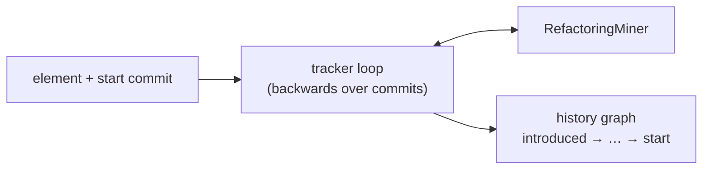

# CodeTracker: codebase onboarding

**Read this first.** It tells you what CodeTracker is in five minutes and which document to read next for your goal. The same reading paths work for a human joiner and for an AI agent. Agents must also follow `AGENTS.md` (spec and plan before code).

## In five minutes

- **What it does:** given one code element at one commit (a method, block, variable, attribute, class, …), CodeTracker builds the list of **earlier commits that changed it, with the kind of change**, back to the commit that introduced it.
- **How:** it walks the file's history **backwards**. At each commit it asks **RefactoringMiner** (RM) which element in the parent *is* this element, even after renames, moves or extract-method refactorings. The result is a **history graph**: versions are nodes, changes are edges.
- **Why it is accurate:** matching uses RM's statement mappings and refactoring detection, not text similarity. The published evaluations (FSE 2022 for methods and variables, TSE 2024 for blocks) are linked from `README.md`.

## Architecture documents

| # | Document | Read it to learn |
|---|---|---|
| 1 | [Overview](docs/architecture/01-overview.md) | The big picture, the package map, dependencies, the three entry points (API, REST, blame). |
| 2 | [Core model](docs/architecture/02-core-model.md) | Elements, **identity** (what "same element" means), the history graph, change types. |
| 3 | [Tracking algorithm](docs/architecture/03-tracking-algorithm.md) | The backward loop and its 5 steps, git vs offline mode, the three loop copies. |
| 4 | [Element trackers](docs/architecture/04-element-trackers.md) | Which classes track which kind, the locator, blame, REST. |
| 5 | [Testing and evaluation](docs/architecture/05-testing-and-evaluation.md) | Test layers, how oracle tests score, practical traps. |

## What to read next, by goal

| Your goal | Read, in order |
|---|---|
| **Use** CodeTracker as a library or service | `README.md` (build, API examples, REST) → [1](docs/architecture/01-overview.md) → [4](docs/architecture/04-element-trackers.md) |
| **Understand** how tracking works | [1](docs/architecture/01-overview.md) → [2](docs/architecture/02-core-model.md) → [3](docs/architecture/03-tracking-algorithm.md) |
| **Change** tracking or matching logic | [2](docs/architecture/02-core-model.md) → [3](docs/architecture/03-tracking-algorithm.md) → `AGENTS.md` (rule zero, conventions) → [5](docs/architecture/05-testing-and-evaluation.md) |
| **Evaluate** a change (oracles, precision, recall) | [5](docs/architecture/05-testing-and-evaluation.md) → the experiments section of `README.md` |

## First hour

1. **Build:** `mvn -q -DskipTests install` (Java 11+, Maven 3.6.3+; `./mvnw` also works). The RefactoringMiner version is `rm.version` in `pom.xml`.
2. **Run one tracker:** see `src/main/java/org/codetracker/Main.java`, or the README's "How to Track Methods". Print `history.getHistoryInfoList()`.
3. **Run one fast test class:** `mvn -q test -Dtest=BlockTrackerImplTest`
4. **Read one tracker end to end:** `MethodTrackerImpl.track()` together with `MethodTrackerChangeHistory`. Every other tracker follows the same pattern.

## Where things are

| Need | Look in |
|---|---|
| Public API | `src/main/java/org/codetracker/api/` (`CodeTracker` builders) |
| The loop for a kind | `src/main/java/org/codetracker/<Kind>TrackerImpl.java` |
| Matching and recording rules | `src/main/java/org/codetracker/<Kind>TrackerChangeHistory.java` |
| Element identity | `src/main/java/org/codetracker/element/` |
| Change types | `src/main/java/org/codetracker/change/Change.java`, `ChangeFactory.java` |
| Oracles (ground truth) | `src/main/resources/oracle/<kind>/{training,test}/` |

## Rules that bite newcomers

- **Three copies of each loop:** `track()`, `blame()` and `*WithLocalFiles.track()`. Change all of them, or better, change `*TrackerChangeHistory`.
- **Identity includes the body** (methods), and the enclosing method (blocks, variables). "Not found by identity" is normal; the matching relies on RM mappings.
- **Every history needs exactly one `introduced` origin.** A node that is queued must be matchable in older commits, or closed with `handleAdd`.
- **Mixed line endings:** most `*ChangeHistory` classes are CRLF, many other classes are LF. Check with `git ls-files --eol <file>` and keep each file's ending (see `AGENTS.md`).
- **Don't edit published oracles**, and don't commit the `oracle` submodule pointer or `experiments/**` outputs.

## Glossary

| Term | Meaning |
|---|---|
| RM | RefactoringMiner: UML models, statement mappings, refactoring detection. |
| Start commit | Where tracking begins. History goes backwards from here. |
| Identity | `identifierIgnoringVersion`: equal strings mean "same element, unchanged". |
| Oracle | Hand-validated expected histories, used to measure precision and recall. |
| Local-files mode | Offline tracking from a commit cache (`oracle/commits`), used by the oracle tests. |
