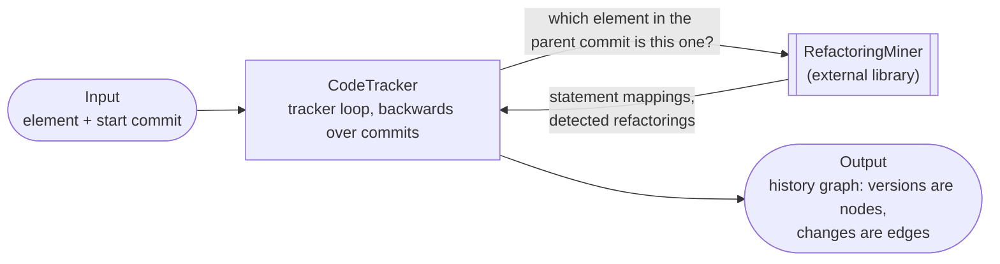

# CodeTracker: codebase onboarding

**Read this first.** It tells you what CodeTracker is in five minutes and which document to read next for your goal. The same reading paths work for a human joiner and for an AI agent. Agents must also follow `AGENTS.md` (spec and plan before code).

## In five minutes

- **What it does:** given one code element at one commit (a method, block, variable, attribute, class, …), CodeTracker builds the list of **earlier commits that changed it, with the kind of change**, back to the commit that introduced it.
- **How:** it walks the file's history **backwards**. At each commit it asks **RefactoringMiner** (RM) which element in the parent *is* this element, even after renames, moves or extract-method refactorings. The result is a **history graph**: versions are nodes, changes are edges.
- **How it achieves robust matching:** it uses RefactoringMiner's statement mappings and refactoring detection rather than relying solely on textual similarity. Its accuracy is evaluated against manually validated histories. The published evaluations (FSE 2022 for methods and variables, TSE 2024 for blocks) are linked from `README.md`.

## Oracles, tests and experiments (read this if "oracle" is new to you)

CodeTracker has two separate jobs. **Tracking** reconstructs the history of a code element. **Evaluation** measures how accurate that reconstruction is. The repository holds the data for both, and they should not be confused.

### What is an oracle?

An oracle is a trusted answer key. Researchers manually checked the history of real elements (methods, blocks, variables, …) in real projects and recorded what really happened to them: introduced in commit A, body changed in commit B, renamed in commit C, and so on. CodeTracker's output is compared with this key. The oracle says what *should* have happened; CodeTracker says what it *believes* happened.

Each change in an oracle JSON file has these fields (from the README): `parentCommitId`, `commitId`, `commitTime`, `changeType`, `elementFileBefore`, `elementNameBefore`, `elementFileAfter`, `elementNameAfter` and `comment`.

### How accuracy is measured

Each expected change is matched with a detected change by its **commit id and change type**. Then:

| Term | Meaning | Example |
|---|---|---|
| **TP** (true positive) | CodeTracker reported a change that really happened. | The oracle says "renamed in commit C" and the tracker reports it. |
| **FP** (false positive) | CodeTracker reported a change that did not happen. | The tracker says "moved", but the element was never moved. |
| **FN** (false negative) | CodeTracker missed a change that did happen. | The oracle says "renamed" and the tracker does not report it. |

- **Precision** = TP / (TP + FP): of everything reported, how much was correct. It is high when the tracker invents few changes.
- **Recall** = TP / (TP + FN): of everything that happened, how much was found. It is high when the tracker misses few changes.

You need both. A tool that reports only changes it is very sure about has high precision and low recall.

### Where the data lives

| What | Where | Role |
|---|---|---|
| **Oracle JSON** | `src/main/resources/oracle/<element>/{training,test}/*.json` | The answer key: expected changes of each element. |
| **Expected scores** | `src/test/resources/<element>/{training,test}-expected.txt` for `method`, `variable`, `attribute`, `block` | One line per history: `file.json, TP, FP, FN`. The oracle tests check that the current code still produces exactly these counts. |
| **Commit logs** | `src/test/resources/<element>/*.json` | The list of commits to analyse for each history, used by the offline oracle tests. |
| **Oracle submodule** | `oracle/commits` (git submodule) | A cache of the source files of the commits involved, so tests run offline without cloning the repositories. |
| **Experiment results** | `experiments/tracking-accuracy/<element>/<tool>/` | The output of a full evaluation run. `final.csv` has the precision and recall for training and test; `summary-*.csv` has one row per history; `detailed-*.csv` has one row per change, showing every success and failure. |
| **Other experiments** | `experiments/execution-time/`, `experiments/gitLog-baseline/` | Runtime plots and a git-log baseline. See the README. |

The `training` and `test` folders are two sets of examples. By convention a training set is what you develop against and a test set is for an independent evaluation. The repository does not state this itself.

### Two different activities

| | Regression testing | Full experiments |
|---|---|---|
| **Purpose** | Check that a change did not break results that used to be right. | Produce new accuracy numbers for a paper or report. |
| **How** | Run the `*OracleTest` for the element you changed. It runs the current code offline from the cache and compares TP, FP and FN per history with the expected scores. | Run the `*ExperimentStarter` for the element. It clones the real repositories, tracks every history, and writes the CSV files. |
| **When** | After changes to tracking logic. | Only when you need a new evaluation. The README gives about 20 minutes for 200 methods and about 2 hours each for 1,345 variables and 1,280 blocks. |
| **Writes to** | Nothing. | Generated experiment outputs under `experiments/`. Existing published result files must remain unchanged. |

### Protecting this data

The published oracles and experiment results are the scientific basis of the papers, so they are protected. The rules (what you may and may not change, and when to run the oracle tests and the full experiments) are in `AGENTS.md`, under "Research integrity and oracle protection".

### Quick memory aid

| Concept | Remember it as |
|---|---|
| Oracle JSON | The answer key. |
| Expected TXT | The expected regression-test scores. |
| Oracle submodule | The source-code cache. |
| Training and test sets | Development examples and independent evaluation examples. |
| Oracle tests | Quick checks that the algorithm has not regressed. |
| Experiments | The full evaluation. |
| `final.csv` | The aggregated results. |
| `detailed-*.csv` | The evidence of each success and failure. |

## Architecture documents

| # | Document | Read it to learn |
|---|---|---|
| 1 | [Overview](docs/architecture/01-overview.md) | The big picture, the package map, dependencies, the three entry points (API, REST, blame). |
| 2 | [Core model](docs/architecture/02-core-model.md) | Elements, **identity** (what "same element" means), the history graph, change types. |
| 3 | [Tracking algorithm](docs/architecture/03-tracking-algorithm.md) | The backward loop and its 5 steps, git vs offline mode, the three execution paths. |
| 4 | [Element trackers](docs/architecture/04-element-trackers.md) | Which classes track which element, the locator, blame, REST. |
| 5 | [Testing and evaluation](docs/architecture/05-testing-and-evaluation.md) | Test layers, how oracle tests score, practical traps. |

## What to read next, by goal

| Your goal | Read, in order |
|---|---|
| **Use** CodeTracker as a library or service | `README.md` (build, API examples, REST) → [1](docs/architecture/01-overview.md) → [4](docs/architecture/04-element-trackers.md) |
| **Understand** how tracking works | [1](docs/architecture/01-overview.md) → [2](docs/architecture/02-core-model.md) → [3](docs/architecture/03-tracking-algorithm.md) |
| **Change** tracking or matching logic | [2](docs/architecture/02-core-model.md) → [3](docs/architecture/03-tracking-algorithm.md) → `AGENTS.md` (rule zero, conventions) → [5](docs/architecture/05-testing-and-evaluation.md) |
| **Evaluate** a change (oracles, precision, recall) | "Oracles, tests and experiments" above → [5](docs/architecture/05-testing-and-evaluation.md) → the experiments section of `README.md` |

## First hour

1. **Build:** `mvn -q -DskipTests install` (Java 11+, Maven 3.6.3+; `./mvnw` does not work in this checkout). The RefactoringMiner version is `rm.version` in `pom.xml`. The first build downloads RefactoringMiner and takes a few minutes.
2. **Run one tracker:** follow the README's "How to Track Methods". Print `history.getHistoryInfoList()`.
3. **Run a fast test:** `mvn -q -o test -Dtest=CodeElementLocatorWithLocalFilesTest` (offline, about 12 s once compiled). Any other class: `mvn -q test -Dtest=<TestClassName>`. The oracle tests may not start yet; see "Known test problem" in `AGENTS.md`.
4. **Read one tracker end to end:** `MethodTrackerImpl.track()` together with `MethodTrackerChangeHistory`. Every other tracker follows the same pattern.

## Where things are

| Need | Look in |
|---|---|
| Public API | `src/main/java/org/codetracker/api/` (`CodeTracker` builders) |
| The loop for an element | `src/main/java/org/codetracker/<Element>TrackerImpl.java` |
| Matching and recording rules | `src/main/java/org/codetracker/<Element>TrackerChangeHistory.java` |
| Element identity | `src/main/java/org/codetracker/element/` |
| Change types | `src/main/java/org/codetracker/change/Change.java`, `ChangeFactory.java` |
| Oracles (ground truth) | `src/main/resources/oracle/<element>/{training,test}/` |
| Specs, plans and design decisions | `docs/specs/` (copy `TEMPLATE.md`), `docs/adr/` |

## Before making changes

This document is an orientation, not a complete specification of CodeTracker.

Before modifying production code:

- Read the relevant architecture documents.
- Inspect the actual implementation rather than relying only on documentation.
- Trace the affected execution path and its callers.
- Identify the related tests and the existing behaviour.
- Follow the planning and implementation requirements in `AGENTS.md`.

If the documentation and the implementation appear inconsistent, do not silently assume either is correct. Report the discrepancy and verify the intended behaviour before you proceed.

## Investigating a tracking problem

When you investigate an incorrect or unexpected tracking result:

1. Identify the affected code element and its start commit.
2. Reproduce the behaviour using the relevant tracker.
3. Inspect the generated history and change types.
4. Trace the matching decision through the relevant `*TrackerChangeHistory` implementation.
5. Inspect the corresponding RefactoringMiner mappings and detected refactorings.
6. Check the relevant oracle and detailed experiment results, when applicable.
7. Identify the smallest relevant regression test.

Do not assume that an incorrect result originates in RefactoringMiner or in CodeTracker without tracing the matching decision.

## Rules that bite newcomers

- **Three tracking execution paths:** CodeTracker has separate implementations for normal tracking (`track()`), blame (`blame()`) and local-files tracking (`*WithLocalFiles.track()`). They share parts of the change-history logic (`*TrackerChangeHistory`) but do not necessarily share the same execution flow. Before modifying tracking behaviour, identify which paths are affected and verify whether the change belongs in the shared `*TrackerChangeHistory` logic or in an individual execution path. Do not assume that changing one path updates the others.
- **Identity changes when the surrounding code changes.** A method's identity includes its body. A block's or variable's identity includes the identity of its enclosing method (or attribute, for a block in a field initializer), so it changes whenever anything in that method changes. So "not found by identity in the parent commit" is normal for blocks and variables: the tracker then uses RefactoringMiner's statement mappings to find the matching element.
- **Every history needs exactly one `introduced` origin.** A node that is queued must be matchable in older commits, or closed with `handleAdd`.
- **Mixed line endings:** most `*ChangeHistory` classes are CRLF, many other classes are LF. Check with `git ls-files --eol <file>` and keep each file's ending (see `AGENTS.md`).
- **Don't edit the published oracles or overwrite the published experiment results** (`final.csv`, `summary-*.csv`, `detailed-*.csv`). Don't commit generated run output (`processed-*.csv`, `error-*.txt`) or the `oracle` submodule pointer. See "Oracles, tests and experiments" above.

## Glossary

| Term | Meaning |
|---|---|
| RM | RefactoringMiner: UML models, statement mappings, refactoring detection. |
| Start commit | Where tracking begins. History goes backwards from here. |
| Identity | `identifierIgnoringVersion`: equal strings mean "same element, unchanged". |
| Oracle | Hand-validated expected histories, used to measure precision and recall. |
| Local-files mode | Offline tracking from a commit cache (`oracle/commits`), used by the oracle tests. |
