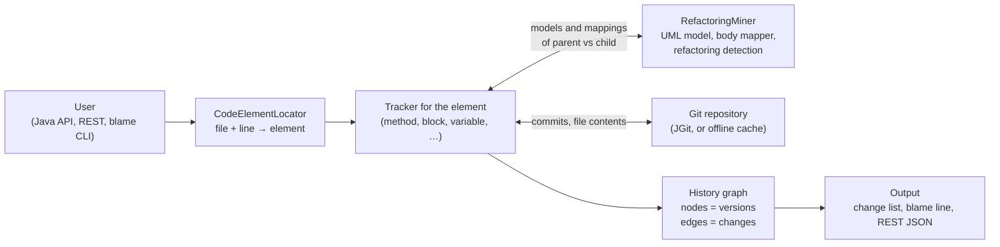

# 1. Overview

## What CodeTracker does

Point CodeTracker at one code element at one commit, for example *"method `fireErrors` in `Checker.java` at commit `119fd4f`"*. It answers: **in which earlier commits did this element change, and how?** It walks the history **backwards**, follows the element through renames, moves and refactorings, and stops at the commit where the element was **introduced**.

It is **refactoring-aware** because it does not compare text line by line. It asks **RefactoringMiner** (RM) which element in the parent commit *is* the same element, even after an Extract Method, a class move or a rename.

## Big picture

## Package map

| Package | Role |
|---|---|
| `org.codetracker.api` | Public interface: the `CodeTracker` builders, `History`, `Graph`, `Edge`, `Version`, `CodeElement`. |
| `org.codetracker` (root) | The engine: one `*TrackerImpl` per element (the loop), and one `*TrackerChangeHistory` per element (matching and recording). Base classes `AbstractTracker`, `BaseTracker`, plus `*WithLocalFiles` variants. |
| `org.codetracker.element` | The tracked things: `Method`, `Block`, `Variable`, `Attribute`, `Class`, `Comment`, `Import`, `Annotation`. Each one wraps an RM object and has an **identity string**. |
| `org.codetracker.change` | What can happen to an element: `Change.Type`, `ChangeFactory`, and one change class per change type and element. |
| `org.codetracker.util` | `CodeElementLocator`, git access (`GitRepository`, `GitHubRepository`), and small helpers. |
| `org.codetracker.blame` | Refactoring-aware `git blame` built on the trackers, with benchmarks against JGit and CLI blame. |
| `org.codetracker.rest` | A small Undertow HTTP server: `/api/track`, `/api/codeElementType`, and two oracle-data endpoints (see doc 4). |
| `org.codetracker.experiment` | Oracle loading and accuracy experiments (precision and recall). |

## External dependencies

| Dependency | Why |
|---|---|
| **RefactoringMiner** (`rm.version`, 3.1.6) | Parses Java into UML models, maps statements between versions (`UMLOperationBodyMapper`), and detects refactorings. **The core of the matching.** |
| JGit | Reads commits, parents and file contents from a local clone. |
| Guava (`graph`) | The history graph. |
| Undertow, Jackson | REST server, JSON (oracles, cache). |

## Three ways in

| Entry point | For | Example |
|---|---|---|
| Java API | Library users, research scripts | `CodeTracker.methodTracker().repository(r).filePath(f).startCommitId(c).methodName("m").methodDeclarationLineNumber(43).build().track()` |
| REST (`org.codetracker.rest.REST`) | The Chrome extension and other UIs | `GET /api/track?…`; see the README |
| Blame (`blame.runner.BlameCLI`, `CodeTrackerBlame`) | Per-line "who changed this last", refactoring-aware | `BlameCLI <file-path>` |

Next: [the core model](02-core-model.md).
