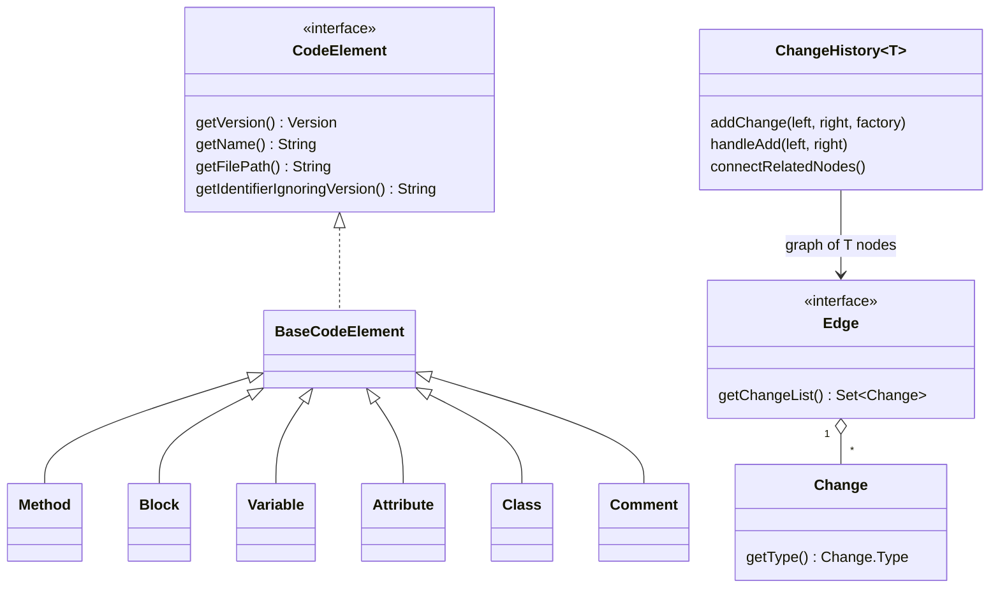
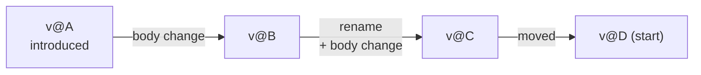

# 2. Core model: elements, identity and the history graph

## The four core ideas

| Idea | Class | In one sentence |
|---|---|---|
| **Version** | `api.Version` / `VersionImpl` | A commit: its id, time and author. |
| **Element** | `element.BaseCodeElement` and subclasses | One code element *at one version*: its RM object, display name, file path and identity. |
| **Change** | `change.Change` (+ `Change.Type`) | What happened between two versions of the element: `body change`, `rename`, `moved`, `introduced`, … |
| **History** | `HistoryImpl` over `ChangeHistory` | A graph: **nodes** are element versions, **edges** carry the set of changes between them. |

## Identity: how "the same element" is decided

Every element has an **`identifierIgnoringVersion`**: a string that is equal for two versions exactly when nothing relevant changed.

| Element | Identity contains | Consequence |
|---|---|---|
| `Method` | source folder, class, visibility, modifiers, name, parameter types, return type, thrown exceptions, annotations, documentation, **body hash** | Any body edit changes the identity. Weaker variants exist: `…IgnoringVersionAndDocumentAndBody` (signature only) and `…IgnoringVersionAndAnnotation`. |
| `Block` | **the enclosing method's identity** + statement type + **SHA-512 of all its statements** + signature | A block's identity changes when *anything* in its method changes. This matters for the comment-transition work. |
| `Variable` | **the enclosing method's identity** + `final` + name + type + annotations + SHA-512 of its scope + scope signature | Same as blocks: variables are matched through RM's statement mappings, not identity alone. |
| `Attribute` | source folder, class, modifiers, visibility, name, type | Independent of method bodies. |

The display **name** is separate. It is what people and the oracles read, for example `src/main/java/org.example.Foo#run(int)$if(42-48)`; it contains line numbers and is not used for matching.

## The history graph

- **Nodes** are created as the tracker finds older versions (`ChangeHistory.addNode`).
- **Edges** go from the older (parent) version to the newer (child) version, and hold one or more changes (`addChange`).
- **`handleAdd`** closes the history with an `introduced` change. *Every history must end in exactly one origin.*
- **`connectRelatedNodes`** links nodes with equal identity, so separately found pieces join into one chain.
- **Evolution hooks** (`change.EvolutionHook`) model one-to-many cases such as a method split or an extracted method: a side branch, while the main chain continues.

## Change types and how they are built

- **`Change.Type`** is an enum with a lower-case **title** (`"body change"`). REST and the oracles look types up by title (`Change.Type.get(title)`).
- **`ChangeFactory`**: `ChangeFactory.forMethod(Change.Type.X)`, `forBlock`, `forVariable`, …, then `.refactoring(...)` when the type needs one. `RENAME` and `TYPE_CHANGE` do; without it they throw a `NullPointerException`. Build every change *before* modifying the history.
- **Families:**

  | Family | Examples |
  |---|---|
  | Lifecycle | `introduced`, `removed` |
  | Body and expression | `body change`, `expression change`, `catch/finally/else block added/changed/removed` |
  | Signature | `rename`, `parameter change`, `return type change`, `modifier change`, `annotation change`, `type change`, `initializer change`, `documentation change` |
  | Location | `moved`, `container change` |
  | Composite | `method split/merge`, `block split/merge`, `loop replaced with pipeline`, … |
  | Comment transitions (this fork) | `commented out …` / `uncommented …` for block, statement, method, attribute and variable |

Adding a new type: give it a unique title, add a change class, and add a `ChangeFactory` case (see `AGENTS.md`).

Next: [the tracking algorithm](03-tracking-algorithm.md).
