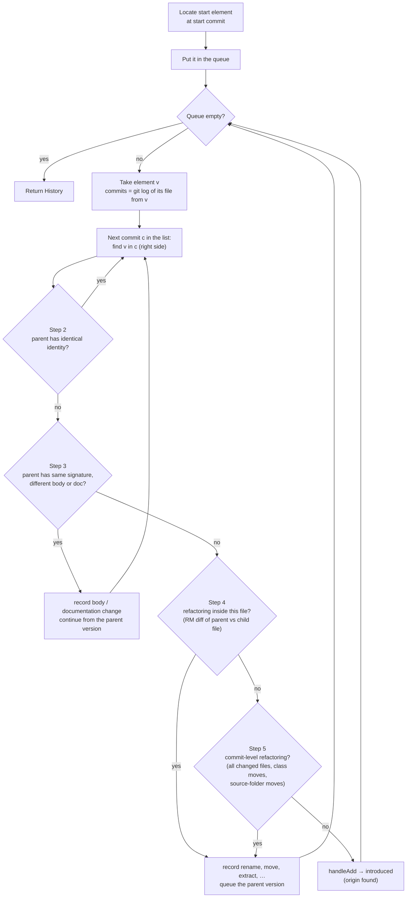
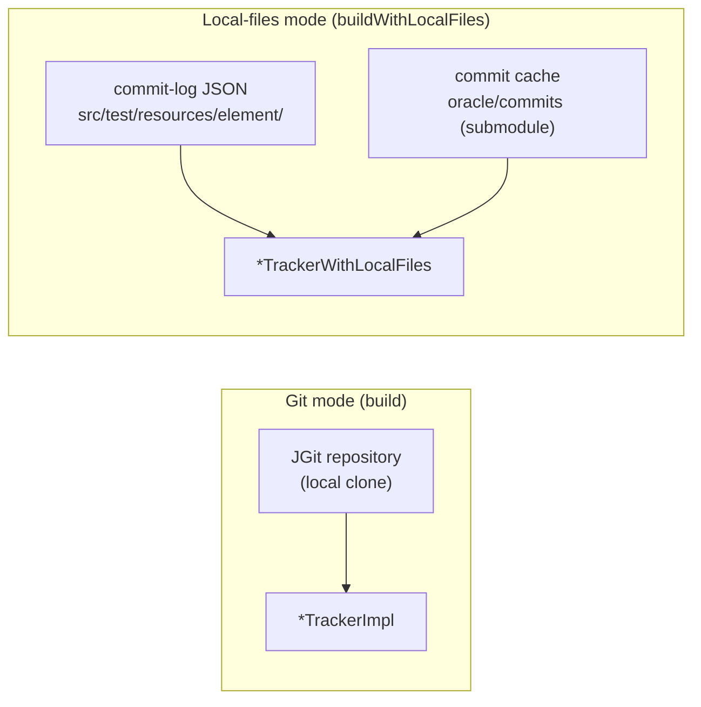

# 3. The tracking algorithm

All trackers share one backward loop, shown here for a method (`MethodTrackerImpl.track()`). The other elements follow the same pattern with their own matching rules.

## The loop

| Step | Cost | What it uses | Typical share of commits (reported in FSE 2022) |
|---|---|---|---|
| 2: no change | cheapest | identity comparison on the parsed file | 67–82% |
| 3: body or documentation change | cheap | identity ignoring body and docs | 9–24% |
| 4: local refactoring | moderate | `leftModel.diff(rightModel)` on one file | ~3–4% |
| 5: commit-level analysis | expensive | `getCommitModel`: all changed files of the commit, `MoveSourceFolderRefactoring`, class moves and renames | ~4–6% |

The heuristics in steps 2–4 are what make CodeTracker several times faster than running RefactoringMiner on every commit.

## Key facts

- **Which commits are visited:** `git log <current version> -- <file>`, newest first, all parents (`RevFilter.ALL`). When a node moves to another file, a new list is computed for that file.
- **Partial models:** only the files that matter are parsed (`getUMLModel(commit, {file})`). The whole commit is parsed only in step 5.
- **Termination:** a node marked `isAdded()` (after `handleAdd`) is not followed further. When the queue is empty, the history is complete.
- **Matching for blocks and variables:** a method's body changes in almost every commit that touches the block, so blocks and variables are matched through RM's **statement mappings** (`UMLOperationBodyMapper`), not through identity alone.

## Three copies of the loop

| Copy | Where | Used by |
|---|---|---|
| `track()` | `*TrackerImpl` (git) | Java API, REST |
| `blame()` | `*TrackerImpl` (git; none for variables) | blame (`HistoryInfo` per line) |
| `track()` | `*TrackerWithLocalFiles` | **oracle tests**: reads `oracle/commits` and commit-log JSON instead of git (`buildWithLocalFiles()`) |

A behaviour change must reach all copies. **Put the logic in `*TrackerChangeHistory`** and keep the loops thin.

## Git mode vs local-files mode

Local-files mode runs the published oracle histories without cloning the 20 repositories. A missing cache entry means *no data*, not an error.

Next: [elements and entry points](04-element-trackers.md).
