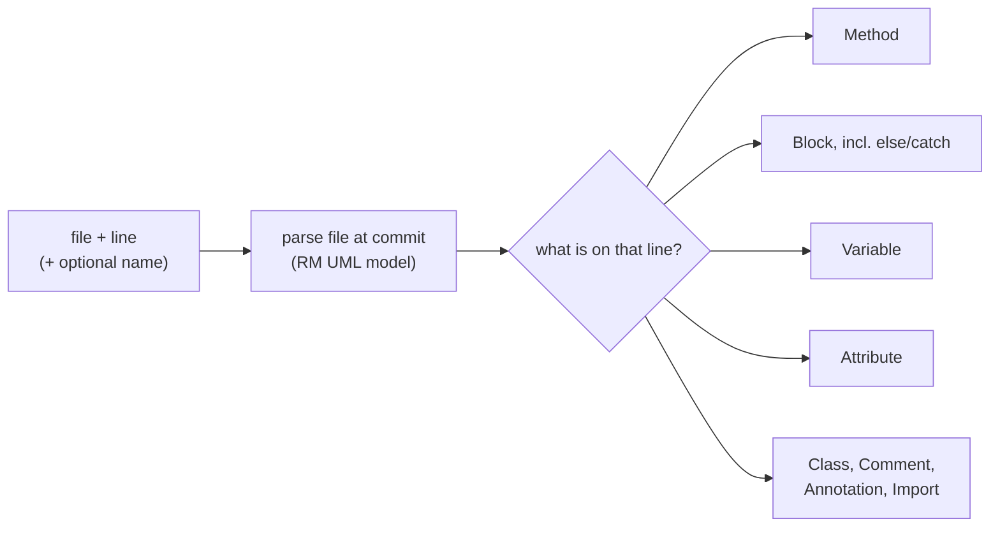
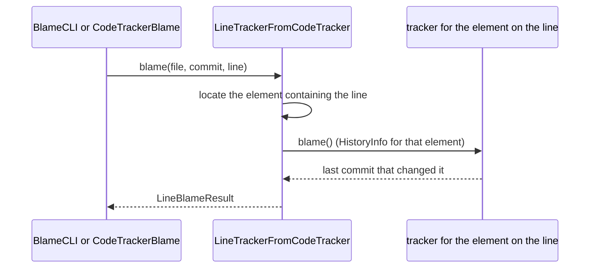

# 4. Elements, entry points, blame and REST

## One tracker per element

| Element | Builder (`api.CodeTracker`) | Loop | Matching and recording | Offline variant | Published oracle (histories) |
|---|---|---|---|---|---|
| Method | `methodTracker()` | `MethodTrackerImpl` | `MethodTrackerChangeHistory` | `MethodTrackerWithLocalFilesImpl` | 200 |
| Variable | `variableTracker()` | `VariableTrackerImpl` | `VariableTrackerChangeHistory` | `VariableTrackerWithLocalFiles` | 1,416 |
| Attribute | `attributeTracker()` | `AttributeTrackerImpl` | `AttributeTrackerChangeHistory` | `AttributeTrackerWithLocalFiles` | 480 |
| Block | `blockTracker()` | `BlockTrackerImpl` | `BlockTrackerChangeHistory` | `BlockTrackerWithLocalFiles` | 1,280 |
| Class | `classTracker()` | `ClassTrackerImpl` | `ClassTrackerChangeHistory` | – | 165 |
| Comment, Import, Annotation | `commentTracker()`, `importTracker()`, `annotationTracker()` | `*TrackerImpl` | `*TrackerChangeHistory` | – | – |
| Whole file (for blame) | – | `FileTrackerImpl` | – | `FileTrackerWithLocalFilesImpl` | – |

Each builder needs a repository, a file path, a start commit and **locator data** (a name plus a declaration line, or a block's start and end lines and its type). The `*ChangeHistory` class holds the rules that decide whether two elements match and which changes to record: `isMatched`, `isAdded`, `analyse*Refactorings`, `is*ContainerChanged`.

## Finding the element: `CodeElementLocator`

The REST endpoint `/api/codeElementType` and blame use it, so users can click a line instead of naming the element.

## Refactoring-aware blame

- The benchmarks (`blame.benchmark`) compare it with JGit and CLI blame (`JGitBlame`, `CliGitBlame`).
- `FileTrackerBlame` blames a whole file.

## REST

`org.codetracker.rest.REST` starts an Undertow server under `/api`. `RESTHandler` serves four endpoints: `/api/track` (the change history as JSON, `RESTChange`), `/api/codeElementType` (which element is on a line), and `/api/addToOracle` and `/api/getOracleData`, which store and read oracle data collected through the UI (currently for blocks only). The parameters of the first two are in the README.

Next: [testing and evaluation](05-testing-and-evaluation.md).
