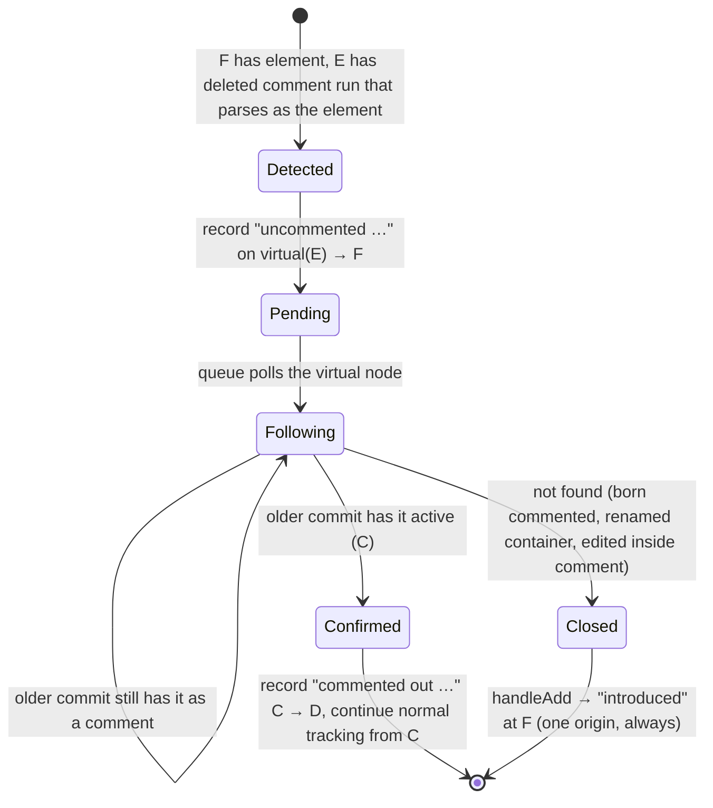

# 5. Comment transitions (this fork)

## The problem

A developer comments code out at commit D and restores it at commit F. Plain CodeTracker sees an element in F that does not exist in E, reports **`introduced` at F**, and loses everything before.

## What the extension records

| Element | Types (title) | Where detected |
|---|---|---|
| Block | `commented out block`, `uncommented block` | `BlockTrackerChangeHistory` |
| Statement inside a tracked block | `commented out statement`, `uncommented statement` (recorded *next to* `body change`, ADR 0005) | `CommentTransitionAnalyzer.detectCommentTransitionsInsideMatchedBlock` |
| Method | `commented out method`, `uncommented method` | `MethodTrackerChangeHistory.isMethodUncommented` |
| Attribute | `commented out attribute`, `uncommented attribute` | `AttributeTrackerChangeHistory` |
| Variable | `commented out variable`, `uncommented variable` | `VariableTrackerChangeHistory` |

## How it works

1. **Detect** (at the point where the loop would say `introduced`):
   - take the comments of the parent that were deleted in this commit (`deletedComments` aligns them in file order, `deletedCommentRuns` passes whole runs);
   - uncomment them **in place** with `CommentedCodeUncommenter`: the comment markers become spaces, so line numbers stay valid;
   - re-parse the result as a *virtual parent*. If the element appears on an uncommented line, it was restored. Edits made during the restore are recorded as `body change` / `expression change` through RM's mapping of the virtual parent.
2. **Follow:** walk older commits of the file, finding the container by **signature**, until the element is active again (`findActiveBlock` for blocks: same kind and signature, and at least half of its statements shared).
3. **Confirm or close:** if an active version is found, record `commented out …` and continue normally. Otherwise give the history its `introduced` origin (`closePending…`).

## `CommentedCodeUncommenter` in short

- **Runs:** consecutive `//` lines form one run; a `/* … */` comment is one run on its own; Javadoc is skipped.
- **Acceptance:** a run is accepted only if it parses as Java statements (blocks, variables) or as class members (methods, attributes). Prose stays a comment.
- **Retry (ADR 0014):** if a run with code-like lines fails to parse, the uncommenter trims up to 3 prose lines at its edges and cuts marker text after the code (`} NOCOMMIT fix this`), then parses again.

## Known limits

- The container must keep its signature while the element is commented out (a renamed method loses the link).
- Edits made *inside* the comment are not recorded.
- Merge commits: a comment-out can be attributed to the merge instead of the first-parent commit.
- Partial restorations (an `else` or `catch` part only) are not supported.

More: `docs/comment-transition/` (phase docs, `HANDOFF.md`) and ADRs 0004–0014 in `docs/adr/`.

Next: [testing and evaluation](06-testing-and-evaluation.md).
