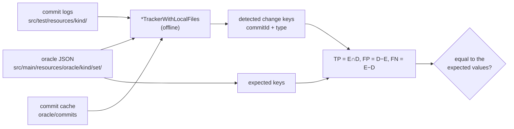

# 5. Testing and evaluation

## Test layers

| Layer | Where | Runs | What it proves |
|---|---|---|---|
| Tracker tests | `src/test/java/org/codetracker/*TrackerImplTest.java`, `BlameTest`, `FalseRenameDetectionTests` | `mvn test -Dtest=…` | Single behaviours on real commits. |
| Locator tests | `util/CodeElementLocator*Test` | `mvn test -Dtest=…` | Finding the element on a line. |
| Published oracles | `util/{Method,Variable,Attribute,Block}OracleTest` | `mvn test -Dtest=…OracleTest` (slow: more than an hour) | The FSE 2022 / TSE 2024 histories: TP/FP/FN must equal the expected values. |
| Experiments | `experiment/*ExperimentStarter` | `main` | Precision and recall tables (`experiments/tracking-accuracy/**`). |

## How an oracle test works

- A change is matched by its key, **commit id + change type**. Element names are not compared.
- `OracleTest` skips some change types when it compares (for example `BlockBodyChange` subclasses); read `OracleTest` before you add a new change type, so you know whether it will be scored.
- The expected TP/FP/FN values are loaded by `OracleTest.loadExpected(...)` from a text file per set and stored in static maps keyed by history file name, so **oracle file names must be unique across all kinds**.

## Practical notes

- `pom.xml` mixes JUnit 5.8.2 (`junit-jupiter-api` and `-engine`) and 5.10.0 (`junit-jupiter`). Mixed versions can break `@MethodSource` tests; if an oracle test fails to start, check this first.
- Don't compile in a checkout while an oracle run uses its `target/`.
- Oracle tests need the `oracle` git submodule (the commit cache). Don't commit the submodule pointer.
- The published oracle files are ground truth. Don't edit them.
- Before and after a change to tracking logic, run the published oracle for the element kind you touched and compare the results with a baseline from the unchanged code.
