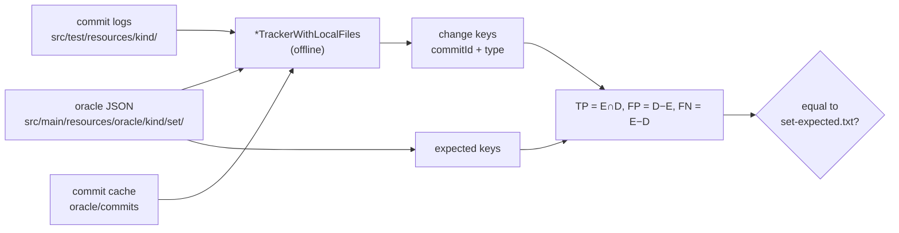

# 6. Testing and evaluation

## Test layers

| Layer | Where | Runs | What it proves |
|---|---|---|---|
| Unit tests | `src/test/java/org/codetracker/**` | `mvn test` (seconds) | Helpers and single behaviours, for example `CommentedCodeUncommenterTest`. |
| Scenario tests | `src/test/java/org/codetracker/commenttransition/*ScenarioTest` | opt-in `-Dct.spec=true` | Synthetic git repositories built in the test; the expected history of each scenario. |
| Published oracles | `util/{Method,Variable,Attribute,Block}OracleTest` | `mvn test -Dtest=…OracleTest` (75–100 min) | The FSE 2022 / TSE 2024 histories: TP/FP/FN must equal `<set>-expected.txt`. |
| Real comment-transition oracle | `util/*CommentTransitionOracleTest` | opt-in `-Dct.oracle=true` (about 3 min) | 42 hand-validated histories from javaparser, elasticsearch and checkstyle. |
| Experiments | `experiment/*ExperimentStarter` | `main` | Precision and recall tables (`experiments/tracking-accuracy/**/final.csv`). |

## How an oracle test works

- A change is matched by its key, **commit id + change type**. Element names are not compared.
- `OracleTest` skips `not changed`, `signature format change` and `BlockBodyChange` subclasses (which includes the statement-level comment transitions).
- **Expected values live in static maps keyed by file name.** Oracle file names must be unique across all kinds: new real-project histories end in `-ct`.

## Practical notes

- `pom.xml` mixes JUnit 5.8.2 and 5.10.0, which breaks `@MethodSource` tests. Run the oracle tests with a temporary pom aligned to 5.10.0.
- Don't compile in a checkout while an oracle run uses its `target/`.
- New real-project histories: the `oracle-history` skill. Published-oracle regression: the `oracle-regression` skill. Both are in `.claude/skills/`.

## Deeper reading

| Topic | Document |
|---|---|
| How to evaluate (oracles, metrics, baselines, what a paper needs) | `docs/evaluation/README.md` (+ PDF) |
| The real comment-transition oracle, results, findings | `docs/comment-transition/oracle/README.md` |
| Design decisions | `docs/adr/` |
