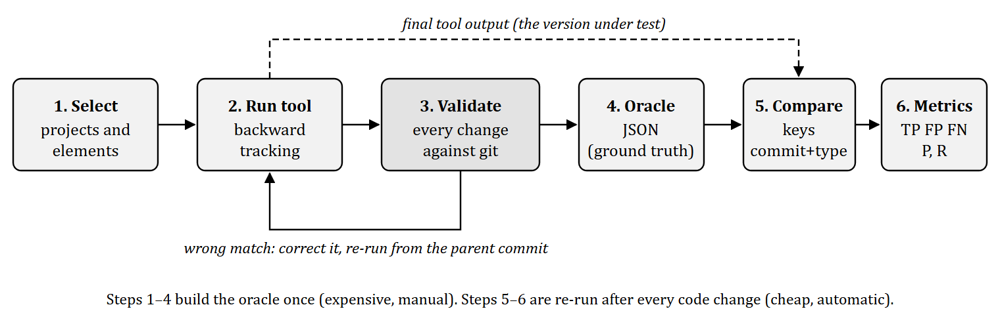
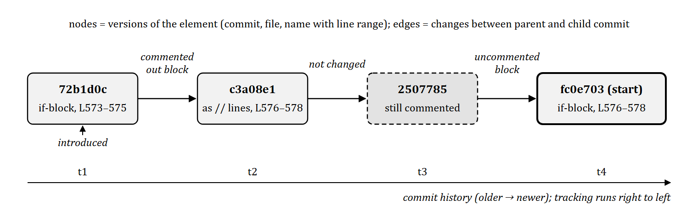
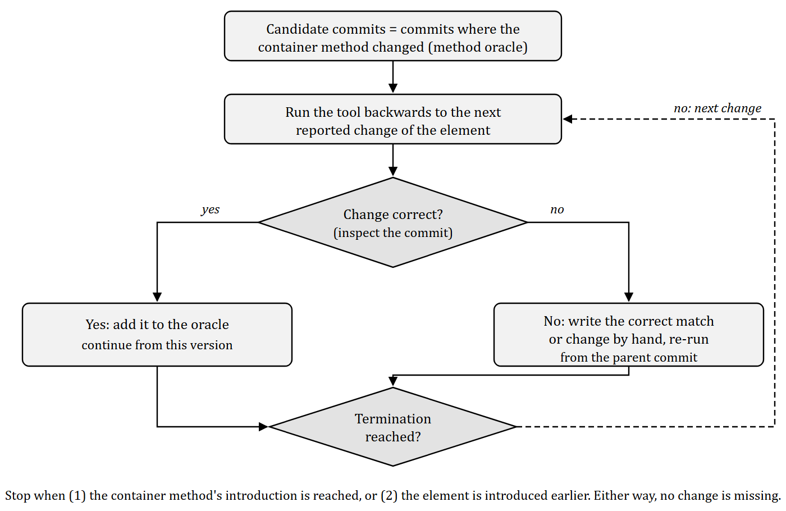
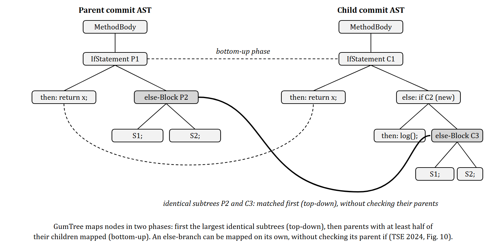
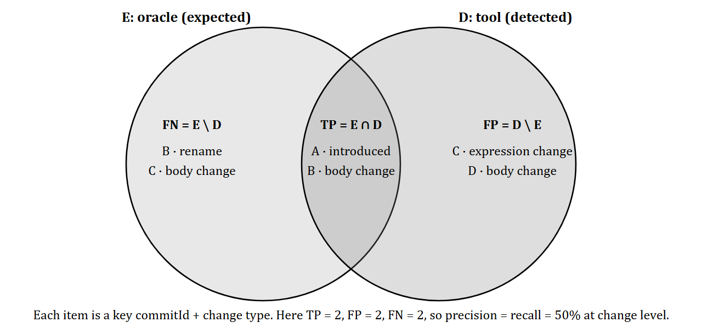
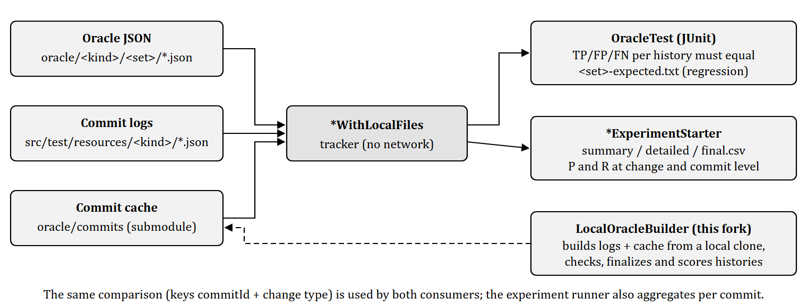

# Evaluating CodeTracker: a practical guide for students

This guide is for students who start working on CodeTracker and need to **evaluate** a change: a new feature, a bug fix, or a new element kind. It explains how the published evaluations were done, what an oracle is, how to build one, how TP, FP, FN, precision and recall are computed in this code base, and what a reviewer (in particular Nikolaos Tsantalis) expects to see in an evaluation section.

A typeset version with diagrams is in [report/](report/) (`Evaluating-CodeTracker.pdf`).

> **One sentence to remember:** a tool is only as good as the oracle it is measured against, so most of the work of an evaluation is building and validating the oracle, not running the tool.



---

## Contents

1. [Vocabulary](#1-vocabulary)
2. [What CodeTracker produces](#2-what-codetracker-produces)
3. [The oracles in this repository](#3-the-oracles-in-this-repository)
4. [How the published oracles were built](#4-how-the-published-oracles-were-built)
5. [How to build a new oracle, step by step](#5-how-to-build-a-new-oracle-step-by-step)
6. [How TP, FP, FN, precision and recall are computed](#6-how-tp-fp-fn-precision-and-recall-are-computed)
7. [Running the evaluation](#7-running-the-evaluation)
8. [Regression checks after changing the code](#8-regression-checks-after-changing-the-code)
9. [Writing the evaluation section of a paper or report](#9-writing-the-evaluation-section-of-a-paper-or-report)
10. [Common mistakes](#10-common-mistakes)
11. [Worked example: the comment-transition oracle](#11-worked-example-the-comment-transition-oracle)

---

## 1. Vocabulary

| Term | Meaning in CodeTracker |
|---|---|
| **Code element** | What is tracked: a method, variable (local or parameter), attribute (field), class, block (`if`, `for`, `try`, …), comment, import or annotation. |
| **Start commit** | The commit where tracking starts. The element is located there by file, name and line number. Tracking goes **backwards** in history. |
| **Change history** | The list of commits in which the element changed, with the **kind** of each change. It ends at the commit where the element was `introduced`. |
| **Change type** | The kind of change: `introduced`, `body change`, `rename`, `moved`, `expression change`, … It is defined in `src/main/java/org/codetracker/change/Change.java` (`Change.Type`), and each type has a lower-case **title** that the oracle files use. |
| **Oracle** | The ground truth: for a set of elements, the *correct* change history of each one, validated by humans. |
| **History (oracle instance)** | One JSON file of the oracle: one element, one start commit, and its expected changes. |
| **True positive (TP)** | A change the tool reports that is also in the oracle. |
| **False positive (FP)** | A change the tool reports that is *not* in the oracle (a wrong report). |
| **False negative (FN)** | A change in the oracle that the tool does *not* report (a miss). |
| **Precision** | TP / (TP + FP): of what the tool reports, how much is right. |
| **Recall** | TP / (TP + FN): of what really happened, how much the tool finds. |
| **Commit level** | Only *which commits* changed the element are compared, ignoring the change types. |
| **Change level** | *(commit, change type)* pairs are compared. This is stricter: a commit with two changes counts twice. |
| **Training / test set** | Two halves of an oracle. In the original CodeShovel oracle, the training half was used to tune the tool and the test half to check it on unseen data. CodeTracker reports both. |

---

## 2. What CodeTracker produces

A tracker (for example `CodeTracker.blockTracker()…build().track()`) returns a `History`. Its core is a **graph**:

- every **node** is a version of the element in one commit (file path, name with line range, commit id);
- every **edge** goes from the older version (parent commit) to the newer one (child commit), and carries a **set of changes** (`Edge.getChangeList()`).

For the evaluation, the graph is flattened into a list of *change records*, one per (edge, change). Each record has:

```
parentCommitId, commitId, commitTime, changeType,
elementFileBefore, elementNameBefore, elementFileAfter, elementNameAfter, comment
```

This flattening is `processHistory(...)` in `src/test/java/org/codetracker/util/OracleTest.java` (tests) and in `src/main/java/org/codetracker/experiment/AbstractExperimentStarter.java` (experiments). `not changed` records are dropped. The test version also drops `signature format change` records (formatting only), and records of the block-body helper type `BlockBodyChange`. That class exists but is never instantiated, so the last filter has no effect today.

Example: a real `if` block in javaparser (`MethodResolutionLogic.isMoreSpecific`), tracked from commit `fc0e703`:

| Commit | Change type | Meaning |
|---|---|---|
| `fc0e703` | uncommented block | the block was turned back into code |
| `c3a08e1` | commented out block | the block was turned into `//` comments |
| `72b1d0c` | introduced | the block was written |



---

## 3. The oracles in this repository

All oracles are JSON files under `src/main/resources/oracle/<kind>/<set>/`:

| Kind | Training | Test | Origin |
|---|---|---|---|
| method | 100 | 100 | Grund et al. (CodeShovel, ICSE 2021), corrected and extended in the FSE 2022 paper |
| variable | 1025 | 391 | FSE 2022: every variable and parameter declared in the 200 methods (1345 in the paper; the repository has grown since) |
| attribute | 358 | 122 | later CodeTracker work: attributes from the classes of the same 20 projects |
| block | 964 | 316 | TSE 2024: blocks inside the 200 methods (1280 in total) |
| class | 77 | 88 | later CodeTracker work: classes from the same 20 projects |
| *comment-transition* | – | – | this fork: 13 real javaparser histories with commented-out and restored code (see section 11) |

Every element comes from the same **20 open-source projects**: checkstyle, commons-io, commons-lang, elasticsearch, flink, hadoop, hibernate-orm, hibernate-search, intellij-community, javaparser, jetty, jgit, junit4, junit5, lucene-solr, mockito, okhttp, pmd, spring-boot and spring-framework. This is deliberate: the variable, attribute and block oracles were built *inside* the methods of the method oracle, which was already validated.

### File format

```json
{
  "repositoryName": "javaparser",
  "repositoryWebURL": "https://github.com/javaparser/javaparser.git",
  "filePath": "javaparser-symbol-solver-core/src/main/java/.../MethodResolutionLogic.java",
  "functionName": "isMoreSpecific",
  "functionKey": "...MethodResolutionLogic#isMoreSpecific(MethodUsage, MethodUsage)",
  "functionStartLine": 557,
  "blockType": "IF_STATEMENT",
  "blockKey": "...#isMoreSpecific(MethodUsage, MethodUsage)$if(576-578)",
  "blockStartLine": 576,
  "blockEndLine": 578,
  "startCommitId": "fc0e7034e15340fe8710c6b3f2ae2068363cc8d6",
  "expectedChanges": [
    {
      "parentCommitId": "2507785…", "commitId": "fc0e703…", "commitTime": 1589750844,
      "changeType": "uncommented block",
      "elementFileBefore": "…", "elementNameBefore": "…$if(576-578)",
      "elementFileAfter":  "…", "elementNameAfter":  "…$if(576-578)",
      "comment": "…"
    }
  ]
}
```

The *locator* fields (file, name, lines, start commit) tell the tracker which element to track. `expectedChanges` is the ground truth. Method, variable and attribute files have the same shape with their own locator fields (`variableName`/`variableStartLine`, `attributeName`/`attributeDeclarationLine`).

### Supporting files

| Path | Purpose |
|---|---|
| `src/test/resources/<kind>/<set>-expected.txt` | One line per history: `file name, TP, FP, FN`. These are the **numbers the current tool gets**, used by the JUnit tests as a regression baseline (section 8). They are not the ground truth. |
| `src/test/resources/<kind>/<repo>-<Class>-<method>.json` | *Commit logs*: for a commit id, the list of commits that touched the file, so the offline trackers never call `git log`. |
| `oracle/commits/` (git submodule `EmpiricalSEConcordia/oracle`) | *Commit cache*: for each commit, the changed Java files before and after, plus metadata. The offline trackers (`*WithLocalFiles`) read it instead of cloning 20 repositories. |
| `experiments/tracking-accuracy/<kind>/<tool>/` | CSV results of the experiment runners (section 7.2), including `final.csv` with the published-style numbers. |

---

## 4. How the published oracles were built

### 4.1 Methods (FSE 2022)

1. **Start from an existing, trusted oracle.** Grund et al. built the change history of 200 methods from 20 projects for CodeShovel, with about 100 hours of manual validation. Reusing it also makes the comparison with CodeShovel fair.
2. **Run the new tool and look at every disagreement.** CodeTracker disagreed with the oracle on 27 methods (18 training, 9 test). In each case the oracle had matched the method with a different method *extracted from its body*, so it followed the wrong method from then on. Some `MethodMove` entries were also really `FileMove`s.
3. **Correct the oracle, and report the corrections.** Wrong entries were removed, new ones added, and *each one was checked on GitHub*. The paper's Table 1 reports, for training and test, how many entries were kept (C), removed (R) and added (N). Reviewers trust an oracle more when its corrections are visible.
4. **Add missing change kinds**, such as annotation and documentation changes, again validated by hand.

### 4.2 Variables (FSE 2022): a semi-automated process

Validating 1345 variables fully by hand was too costly, so the paper used the method oracle to narrow the search:

1. A variable can only change in a commit where its **container method** changed, so only those commits are candidates.
2. Run the tool backwards on those commits.
3. **Validate every reported change** by inspecting the commit.
   - If it is right, add it to the oracle.
   - If it is wrong (a wrong variable match), find the right match or change by hand, add *that*, and **continue tracking from the parent commit** of the corrected match.
4. Stop at one of two **termination conditions**:
   - the tracking reaches the commit where the container method was introduced (the variable existed from the start); or
   - the variable is introduced before that (it was added later as new code, or came from an inlined method).

   Reaching a termination condition guarantees that no variable change is missing.

The same idea applies to blocks: a block only changes when its method changes.



### 4.3 What the papers measured (research questions)

The FSE 2022 paper is a good template. It has four RQs:

| RQ | Question | Measured by |
|---|---|---|
| RQ1 | Method tracking accuracy, compared to CodeShovel | precision and recall at commit and change level, training and test |
| RQ2 | Variable tracking accuracy | same, CodeTracker only (no other tool tracks variables) |
| RQ3 | Execution time compared to CodeShovel | per-method tracking time (`System.nanoTime`), median and average, log-scale box plots, same machine, repositories cloned locally beforehand |
| RQ4 | Speed-up over plain RefactoringMiner | the same tracking with RefactoringMiner's full commit analysis |

Results it reported: methods 99.97% precision and 100% recall at commit level, and 99.87% / 99.93% at change level. Variables: 99.85% / 99.95% at commit level and 99.66% / 99.85% at change level.

**Fairness rules** it stated explicitly, because tools use different change vocabularies:

- CodeShovel reports `BodyChange` for edits to inline comments, where the oracle says `DocumentationChange`. This was counted as a TP for CodeShovel.
- CodeShovel reports one coarse `ParameterChange`, where CodeTracker reports finer kinds. The coarse report was also counted as a TP.

**Every FP and FN of the proposed tool is explained** in the text, with a concrete example (project, commit, why it happened). For instance, three FPs came from a method-merge case in javaparser, and the others from RefactoringMiner reporting a `FileMove` instead of a `MoveMethod`.

### 4.4 Blocks (TSE 2024)

The block paper (TSE 2024) reuses the same 200 methods and adds every block inside them: **1,280 blocks** (964 training, 316 test), with **6,093 validated changes**. Validation took **three person-months**. Its RQs are RQ1 (accuracy, compared to baselines) and RQ2 (execution time).

**How the block oracle was validated:**

1. As for variables, the commits where a block can change are a subset of the commits where its method changed.
2. A modified version of CodeTracker's **Chrome extension** showed each reported commit on GitHub, scrolled to the block. The validator (one of the authors) confirmed or rejected each reported match and change.
3. **Matching criterion, written down explicitly:** two blocks are the same block when they *share some common functionality*, even if refactored or rewritten with other APIs. Blocks with different functionality are not the same block, even if they sit at the same place in the control structure.
4. When a match was wrong, the validator wrote the correct parent block into the JSON, re-ran CodeTracker from the parent of the faulty commit, and continued.
5. The process uses the same two **termination conditions** as for variables: the method's introduction is reached, or the block is introduced earlier.

**Baselines**, built because no existing tool tracks blocks:

- **GumTree-based baseline.** GumTree 3.0 is the state-of-the-art AST diff tool. It maps the nodes of the parent and child abstract syntax trees, in a top-down phase (largest identical subtrees) followed by a bottom-up phase (nodes with at least half of their children mapped). The baseline is CodeTracker's algorithm with GumTree's node mappings instead of RefactoringMiner's statement mappings. For blocks moved to another file, it uses two-stage tree matching (Fujimoto et al.), with RefactoringMiner used only to find the origin file.
- **`git log -L` baseline.** Line-range tracing from the block's start and end lines in the start commit. It gives commits only, so it is evaluated **at commit level only**.



**Fairness rules** stated in the paper:

- GumTree maps each node to at most one node, so for **block merges** only the history of the merged block with the largest overlap is in the ground truth (14 merges).
- Commits that `git log -L` reports *before* the block's true introduction are not counted as FPs: it did trace the block to its origin.
- When `git log -L` derails on whole-file reformatting (line endings, tabs/spaces; detected as more than 95% of lines changed only in whitespace), it is restarted from that commit with the correct line range.
- For execution time, the RefactoringMiner move detection used by the GumTree baseline was cached, so its cost is not counted against the baseline.

**Results:**

| Level | Tool | TP | FP | FN | Precision | Recall |
|---|---|---|---|---|---|---|
| commit | GumTree baseline | 4735 | 271 | 929 | 94.59% | 83.60% |
| commit | `git log -L` | 4730 | 1689 | 934 | 73.69% | 83.51% |
| commit | CodeTracker | 5651 | 12 | 13 | 99.79% | 99.77% |
| change | GumTree baseline | 4798 | 607 | 1296 | 88.77% | 78.73% |
| change | CodeTracker | 6063 | 31 | 31 | 99.49% | 99.49% |

(Overall = training + test. The paper also gives each set separately.)

**How errors are discussed.** Each FP/FN pattern is shown with a figure of the real diff and ends in an *Insight*: the exact conditions under which the tool fails. For example, Insight 1 says, in short, that CodeTracker cannot match two blocks when no nested statement is matched, their conditions differ, and no extract or inline method explains the body. Baselines' errors are explained too, for example GumTree matching an `else` branch without its `if`. The paper also explains *why* recall differs between sets: training histories are longer, so an early miss costs more FNs.

**Execution time.** CodeTracker took a median of 2 s and an average of 3.6 s per block. The GumTree baseline took a median of 10 s and an average of 21 s, so it is about 5 to 6 times slower. A table shows the share of commits handled by each tracking step.

---

## 5. How to build a new oracle, step by step

This is the recipe used for the comment-transition oracle (section 11). It follows the papers' principles.

### Step 1: Decide what you measure

Write down which change types you evaluate, and **define each one precisely** before you look at data. For example: "`uncommented statement`: a statement inside the block, at any depth, that was a comment in the parent commit and is code in the child commit". Ambiguous definitions are the main source of oracle disagreements.

### Step 2: Find candidate elements

- **Random sampling** (the papers' approach for general accuracy): take elements from a fixed set of projects, spread across projects (the method oracle has 10 methods per project).
- **Targeted mining** (for a rare phenomenon, such as commented-out code): scan the history for the phenomenon. `docs/comment-transition/tools/MineCommentTransitions.java` reads `git log -p -U0` and finds commits where removed code reappears as `//` lines, or the reverse.

Rare phenomena need targeted mining: a random sample of 200 methods may contain none.

### Step 3: Choose the start commit and locate the element

Pick a commit where the element exists, then record its file path, name and line numbers *at that commit* (`git show <commit>:<file>`).

### Step 4: Run the tool, but do not trust it

`LocalOracleBuilder` (in `src/test/java/org/codetracker/util/`) runs the git-based tracker on a local clone and writes its output in oracle format. This output is only the **starting point** for validation.

### Step 5: Validate every change against git

For every reported change, look at the element's code in the parent and the child commit and decide whether it is right and correctly typed. Useful tools:

- `git log -L <start>,<end>:<file> <startCommit>`: the commits that changed those lines, followed back through history. It is good for finding **misses**. It over-approximates (it also shows neighbouring edits), so read each hunk.
- `git log -L :<methodName>:<file>`: the same for a whole method.
- `docs/comment-transition/tools/blockevo.sh`: prints a block's text at every version of the file and flags each version where it changes, or switches between code, commented and absent.
- `LocalOracleBuilder check`: for each reported change, prints the lines that differ before and after; then it flags every *unreported* commit that touches one of the element's lines. Inspect every flag.

Also check the **origin**. Is the `introduced` commit really where the element was born, or was it moved from another file, extracted from another method, or renamed? Look at the whole commit, not only the file.

### Step 6: Record the decisions

For every history, keep a short note of *how* it was validated and *why* each correction was made. In this fork these are the `docs/comment-transition/oracle/verdicts/*.verdict.json` files. When a reviewer asks "why is this an FN?", the answer is already written down.

### Step 7: Write the oracle file and the baseline

`LocalOracleBuilder finalize` writes the validated changes into the JSON. `LocalOracleBuilder score` runs the offline tracker as the tests do and gives the `TP, FP, FN` line for `<set>-expected.txt`.

### Step 8: Make it reproducible offline

The offline trackers need commit logs and cache entries. `LocalOracleBuilder` writes both from a local clone, in the same format as the GitHub-API cache, so no token is needed. Keep new histories in a **separate set** (a new folder name), so the published numbers stay comparable.

---

## 6. How TP, FP, FN, precision and recall are computed

### 6.1 The key

Every change becomes a **key**:

```
key = commitId + "-" + changeType
```

(`getChangeKey` in `OracleTest` and `AbstractExperimentStarter`.) Two changes match when their keys are equal. The element names and file paths are **not** compared; they are only there to help humans.

Consequences:

- Two changes of different types in the same commit are two keys (for example `body change` and `expression change`).
- Two changes of the *same* type in the same commit collapse into one key.
- If the tool reports the right commit with the wrong type, that counts as **one FP and one FN**.

### 6.2 Per history

```
E = set of keys in the oracle (expected)
D = set of keys the tool reports (detected)

TP = |E ∩ D|        FP = |D \ E|        FN = |E \ D|
```

This is exactly the loop in `OracleTest.testCodeTracker` and `AbstractExperimentStarter.codeTracker`.



### 6.3 Over the whole oracle (micro-average)

TP, FP and FN are **summed over all histories first**, and precision and recall are computed from the sums:

```
Precision = ΣTP / (ΣTP + ΣFP)        Recall = ΣTP / (ΣTP + ΣFN)
```

This is `calculateFinalResults` in `AbstractExperimentStarter`, written to `final.csv`. Long histories therefore weigh more than short ones. (A macro-average would compute precision per history and average the results. The papers do not do that.) If you also want a single number, F1 = 2PR / (P + R). The CodeTracker papers report P and R, not F1.

### 6.4 Commit level

For each history, the keys are reduced to their **commit ids**:

```
Ec = commits of E      Dc = commits of D
TPc = |Dc| − |Dc \ Ec|     FPc = |Dc \ Ec|     FNc = |Ec \ Dc|
```

Commit-level numbers are always at least as good as change-level ones: a right commit with a wrong type is a TP at commit level but an FP plus an FN at change level.

### 6.5 Worked example

Oracle: `A introduced`, `B body change`, `B rename`, `C body change`.
Tool: `A introduced`, `B body change`, `C expression change`, `D body change`.

| Level | TP | FP | FN | Precision | Recall |
|---|---|---|---|---|---|
| change | 2 (`A introduced`, `B body change`) | 2 (`C expression change`, `D body change`) | 2 (`B rename`, `C body change`) | 50% | 50% |
| commit | 3 (A, B, C) | 1 (D) | 0 | 75% | 100% |

### 6.6 Per change type

The experiment runner also writes TP/FP/FN **per change type** to `summary-*.csv`, one column triple per `Change.Type`. Use this to show *where* errors are, for example "all 3 FNs are `moved`". It is also how the papers fill their "instances per change kind" tables.

### 6.7 What is not counted

- `not changed` (no change).
- In the JUnit tests only: `signature format change` (whitespace in a signature), and `BlockBodyChange` (unused).
- In the per-type CSV columns: `changed multiple times` and `removed`.

---

## 7. Running the evaluation



### 7.1 JUnit oracle tests (regression)

```bash
mvn test -Dtest=BlockOracleTest      # also MethodOracleTest, VariableOracleTest, AttributeOracleTest
```

- They use the offline trackers (`buildWithLocalFiles()`) and the commit cache, so `git submodule update --init` must have fetched `oracle/`.
- Each history is one parameterised test. It **passes when its TP/FP/FN equal the line in `<set>-expected.txt`**: the test checks for *no change from the baseline*, not perfection.
- On this branch, `pom.xml` mixes JUnit 5.8.2 and 5.10.0, which breaks `@MethodSource`. Use a temporary pom with every JUnit version set to 5.10.0 (see `docs/comment-transition/tools/run-oracles.sh`).
- Time: about 40 minutes for methods, and more than an hour for all four kinds. Run them in the background, and do not compile in the same checkout while they run.

### 7.2 Experiment runners (numbers for a paper)

`org.codetracker.experiment.<Kind>ExperimentStarter.main` runs every history of the training and test oracles and writes to `experiments/tracking-accuracy/<kind>/tracker/`:

| File | Content |
|---|---|
| `summary-tracker-<set>.csv` | one row per history: time, analysed commits, step counters, TP/FP/FN per change type, totals |
| `detailed-tracker-<set>.csv` | one row per change: its key data and `TP`, `FP` or `FN` |
| `final.csv` | per set and level (change, commit): average and median time, ΣTP, ΣFP, ΣFN, precision, recall |
| `processed-*.csv`, `error-*.json.txt` | progress and per-history exceptions (do not commit them) |

They resume where they stopped (`processed-*.csv`). Delete the outputs for a clean run.

### 7.3 Execution time

As in the paper: same machine, repositories prepared beforehand, time per tracked element with `System.nanoTime`, report **median and average**, and show box plots on a log scale. Report the hardware and JVM settings (CPU, RAM, OS, Java version, `-Xmx`).

---

## 8. Regression checks after changing the code

A new feature must not break the existing results. The protocol used for the comment-transition work:

1. Run all oracle tests on a **baseline** checkout (the commit before your change; use `git worktree add`).
2. Run them on your **final** checkout.
3. Compare per history: `java docs/comment-transition/tools/CompareOracle.java <reports-base> <reports-final>`.
4. Explain **every** difference. It is either:
   - a regression to fix;
   - an expected effect, such as new change types that the old oracle does not know, which count as FPs until the oracle is updated; or
   - noise.

Because each oracle test checks for *no change*, a failing test after your change is information, not necessarily a bug. If the change is an improvement, update `<set>-expected.txt`, and say why in the commit message.

---

## 9. Writing the evaluation section of a paper or report

What Nikolaos's papers always contain, and reviewers expect:

1. **Research questions**, stated first and answered one by one, each ending with a one-sentence *finding*.
2. **The oracle**: its source, size, how it was built and validated, how much manual effort it took (FSE 2022: "approximately two person-months"), and the corrections made to existing oracles (with counts).
3. **Tables of TP, FP, FN, precision and recall**, for training, test and overall, at commit and change level.
4. **Comparison with the state of the art** on the *same* oracle, with every fairness rule stated.
5. **An explanation of every FP and FN** of your tool, with a concrete example (project, commit, cause). Group them by cause.
6. **Execution time**, with the machine description.
7. **Threats to validity:**
   - *internal*: oracle construction errors, and how you reduced them;
   - *external*: few projects, and why that is acceptable (comparability);
   - *construct*: what the change types do and do not capture (for example, variable initializer changes are not tracked).
8. **Data availability**: tool, oracle and scripts public, so others can replicate.

---

## 10. Common mistakes

- **Building the oracle from the tool's output without independent validation.** This only measures agreement with yourself. Always inspect the commits, and search for misses (`git log -L`, the flagging check).
- **Changing a published oracle silently.** Add new histories in a new set. If you correct existing entries, report how many were kept, removed and added.
- **File-name collisions.** `OracleTest` keeps expected values in static maps keyed by history *file name*, shared across test classes. Use unique names (this fork appends `-ct`).
- **Confusing `expected.txt` with ground truth.** It is the tool's current score.
- **Whitespace or formatting.** Formatting-only edits are not changes.
- **Rebased histories.** `commitTime` is not topological, so sort by ancestry when you reason about order.
- **Not following moves.** Check the whole commit before you accept `introduced`.
- **Counting the start-commit node as a change.** Only edges carry changes.

---

## 11. Worked example: the comment-transition oracle

The comment-out/uncomment detection of this fork was first tested only with synthetic scenarios. To measure it on real code, 27 histories were mined from javaparser (13) and elasticsearch (14) and validated as in section 5. Full details are in `docs/comment-transition/oracle/README.md`. The results show why real data matters:

| Measure | TP | FP | FN | Precision | Recall |
|---|---|---|---|---|---|
| javaparser, all change types | 51 | 3 | 13 | 94.4% | 79.7% |
| elasticsearch, all change types | 18 | 9 | 65 | 66.7% | 21.7% |
| Both, all change types | 69 | 12 | 78 | 85.2% | 46.9% |
| Both, comment-transition types only | 18 | 1 | 27 | 94.7% | 40.0% |
| *After the fix, with checkstyle and 6 more elasticsearch histories (42 histories)*, all change types | 204 | 6 | 27 | 97.1% | 88.3% |
| *Same, comment-transition types only* | 58 | 1 | 14 | 98.3% | 80.6% |

**Lessons for your own evaluation:**

1. **The synthetic scenarios all passed (27/27), but real code failed often.** The main cause was never in a scenario. Developers put a prose note above commented-out code (`// source is always enabled for now`) or a marker inside it (`//    } NOCOMMIT fix this`), and this one habit explains 8 of the 14 elasticsearch misses.
2. **A second project changed the picture.** javaparser alone suggested 80% recall; elasticsearch showed 22%. One project is not enough to generalise.
3. **One miss can cost a whole history.** A single missed restoration in `TransportTwoNodesSearchIT` costs 24 FNs: the entire history before it. Report per-history results next to the totals, so readers can see this.
4. **Check the scoring code, not only the tool.** One apparent defect (missing statement-level transitions) turned out to be `OracleTest` filtering those change types out. Before you report an FN, confirm with the raw tracker output that the tool really missed it.
5. **Name collisions in the harness.** The regression run showed one published method history "failing". The cause was another oracle history with the same file name overwriting its expected values (section 10).

6. **Projects differ in how much material they offer.** checkstyle (16,684 commits) yielded only 9 usable histories, because it checks its own code against commented-out code and deletes dead code. elasticsearch (100,544 commits) yielded 20. When an oracle must cover a rare phenomenon, mine several projects and report how many candidates each produced.
7. **Measure, fix, re-measure.** The oracle pointed at one dominant cause, so it was fixed and both projects were re-scored with the same oracle. Recall went from 46.9% to 87.8% and precision from 85.2% to 96.3%, with no history getting worse. The re-scoring also caught two new weaknesses that the first fix made reachable. They were fixed before the published oracles were re-run (`docs/comment-transition/phase-7.md`).

A good evaluation finds the limits of a tool, not only its successes.
